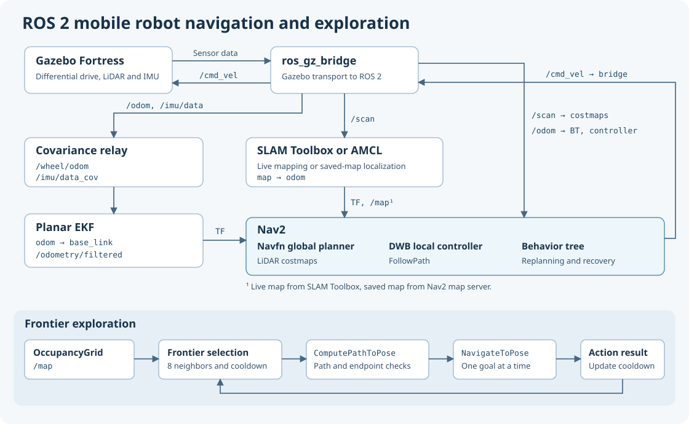

# ROS 2 Mobile Robot Navigation and Exploration

[简体中文](README.zh-CN.md)

A differential-drive robot integrates planar state estimation, SLAM, localization, path planning, and autonomous exploration in ROS 2 Humble and Gazebo Fortress. It can explore using a live map or patrol fixed waypoints on a saved map.

| Technical area | Work in this project |
| --- | --- |
| State estimation | Integrated simulated IMU and wheel odometry, applied a lateral velocity constraint, and verified short-term EKF behavior. |
| Navigation reliability | Analyzed Navfn goal tolerance and added a path feasibility and endpoint check before sending a navigation goal. |
| Autonomous exploration | Added spatial cooldowns, action result handling, and bounded candidate searches to the upstream frontier detector. |



No Gazebo or RViz capture, video, or GIF from these experiments was available for publication. The saved occupancy grid and verification record are included. [Map metadata](maps/frontier_explore_v1.yaml) · [Experiment record](experiments/2026-11-26-verification.md)

## System architecture

- Gazebo supplies `/scan`, `/odom`, `/imu/data`, `/joint_states`, and `/clock` through `ros_gz_bridge`. The bridge sends `/cmd_vel` back to the differential drive.
- The covariance relay publishes `/wheel/odom` and `/imu/data_cov`. The EKF publishes `/odometry/filtered` and owns `odom → base_link`. The bridge does not forward Gazebo TF. The robot state publisher provides the robot's link transforms.
- In mapping mode, SLAM Toolbox publishes `/map` and `map → odom`. In saved-map mode, the Nav2 map server publishes `/map` and AMCL publishes `map → odom`. Both modes use laser scans and the odometry TF chain.
- Nav2 combines these transforms with the map and LiDAR costmaps. The BT Navigator explicitly consumes raw Gazebo `/odom` and, in the default namespace, the Controller Server's relative `odom` subscription resolves to the same topic. Filtered odometry and EKF TF are distinct outputs. Selecting the EKF odometry topic for a Nav2 consumer would change its velocity input and needs its own evaluation.

## State estimation

The planar `robot_localization` EKF combines wheel `vx`, `vy`, and `wz` with IMU `wz`. The relay keeps the wheel odometry's near-zero lateral velocity and assigns that measurement a provisional variance of `1.0e-5`. For a differential drive under negligible sideslip, this gives the filter a measured constraint on lateral velocity. The EKF runs at 30 Hz and publishes `odom → base_link`.

The EKF experiment checked the input topics, parameter loading, lateral covariance at rest, and agreement with Gazebo odometry during short backward and rotational movements. Gazebo `/odom` is the reference signal used in these comparisons. [EKF verification record](experiments/2026-11-26-verification.md#ekf)

## Navigation and path planning

Nav2 uses the Navfn global planner (`GridBased`) and DWB's `FollowPath` local controller. The LiDAR obstacle layers and inflation layers support local obstacle avoidance. The global costmap also uses the occupancy map. The `NavigateToPose` behavior tree coordinates planning, path following, replanning, and recovery. The configured behavior server provides spin, backup, drive-on-heading, and wait. Navfn, DWB, and the behavior tree are Nav2 components.

The navigation launch applies the main parameter file before the controller-specific override. The DWB `FollowPath.critics` list comes from the main YAML. The launch applies the simulation clock, the optional Nav2 namespace, the NavigateToPose BT path, and the static map subscription setting. The tested setup uses the default namespace. Starting Nav2 in another namespace also requires matching its inputs and action clients.

## Autonomous exploration

The inherited detector identifies free cells adjacent to unknown cells in their eight-neighborhood. It scans the interior of the occupancy grid in row order. The current version converts each candidate's cell center to map coordinates using the grid resolution, origin translation, and origin yaw.

Each search round may check up to eight candidates outside the active cooldown regions. The explorer calls `ComputePathToPose` asynchronously with `GridBased`. It requires a successful plan with at least two poses and an endpoint within `0.1 m` of the candidate. It sends one `NavigateToPose` goal at a time, handles the result, and resumes on a later map update. If the navigation server is unavailable at dispatch, the explorer releases the candidate and waits for the next update while leaving the executor free to process callbacks.

Cooldown takes 180 seconds of monotonic time. The exclusion radius is `0.45 m` after success, `0.65 m` after a rejected path check or aborted navigation, and `0.60 m` after a rejected or canceled navigation goal.

## Engineering challenges and solutions

| Symptom | Investigation and change | Evidence |
| --- | --- | --- |
| Lateral EKF covariance grew abnormally at rest | Checked the wheel and IMU input topics and the EKF parameter loading. Fused the wheel lateral velocity with an explicit variance using the differential-drive constraint. | The recorded 60-second stationary check showed no recurrence of the extreme covariance divergence. |
| Navigation could report success repeatedly near the same frontier | Navfn tolerance allows a path endpoint near the target. With `0.5 m`, the path could end away from the intended frontier, and Nav2 also has a separate `0.25 m` navigation goal checker. Reduced Navfn tolerance to `0.1 m`, added an endpoint check, and cooled down completed targets. | Read the planner tolerance at runtime. In the exploration run, the robot moved through multiple regions. |
| Border or obstacle-adjacent candidates repeatedly triggered failed navigation | The upstream explorer dispatched goals directly. Asynchronous path prechecks now reject failed plans, short paths, or paths with an excessive endpoint error. Attempted regions cool down for 180 seconds. | Recorded runs rejected unplannable candidates before dispatch. Round logs show total candidates, filtered candidates, checks, planning rejections, and whether the check limit was reached. |
| Nav2 launch could fail to activate DWB | The combined launch allowed SLAM's `params_file` to leak into Nav2, which failed to load its critics. Separate Launch scopes fixed that issue. Nav2 now applies its rewritten main YAML before the controller override. Staged startup also allows the clock, sensors, TF, and action servers to become available. | Before the scope fix, the startup log contained `No critics defined for FollowPath`. The controller activated after the fix. |

## Experimental evaluation

The frozen 2026-11-26 exploration run sent **4 navigation requests**, with **3 `SUCCEEDED`** and **1 `ABORTED`**. Multiple candidates failed prechecks and were filtered before navigation. This sample describes one run in the test room.

| Historical exploration map | Result |
| --- | ---: |
| Grid size | 239 × 239 |
| Resolution | 0.05 m/cell |
| Free / occupied / unknown cells | 53,522 / 2,107 / 1,492 |
| Known / unknown cells | 97.39% / 2.61% |
| Remaining frontier cells / eight-connected components | 30 / 12 |

**97.39% is the known-cell fraction within the saved map rectangle.** The experiment did not measure coverage of all reachable space or establish an exploration completion criterion.

| Historical EKF check | Gazebo odometry | EKF odometry | Absolute difference |
| --- | ---: | ---: | ---: |
| Short backward move | −0.101525 m | −0.101032 m | 0.000493 m |
| Short rotation | 22.4198° | 22.5586° | 0.1388° |

These checks compare short-term behavior against the simulated wheel odometry input. The values do not establish long-term accuracy. The artifacts describe the frozen run. Candidate positions in the revised explorer use cell centers, so its trajectories and goal outcomes can differ. [Historical experiment record](experiments/2026-11-26-verification.md) · [Saved map files](maps/)

The revised package passed a clean build and the frontier unit tests. In a short server-only Fortress run, DWB activated with seven critics and Navfn used `0.1 m` tolerance. Two prechecked frontier goals succeeded. One goal was rejected before Nav2 finished activating, and one was still in progress when the check ended. The round logs also recorded eight rejected prechecks in a round that reached the check limit. Standalone SIGINT tests exited cleanly for both the explorer and the covariance relay.

In a separate saved-map check, AMCL accepted the initial pose and the first patrol waypoint succeeded. The revised run timed out after repeated controller progress failures at the second waypoint `(2, 1)`. The published baseline hit the same failure there, eventually reached the second waypoint, and timed out on the third. The two runs establish that the progress failure also occurs on the baseline. More repetitions are needed to compare patrol reliability. The rerun covered server-only simulation. GUI operation and extended exploration were outside its scope.

## Reproduction

### Install and build

Use Ubuntu 22.04, Python 3, ROS 2 Humble, and Gazebo Fortress (Gazebo Sim 6.x). Install `rosdep` and `colcon`. For a fresh `rosdep` setup, run `sudo rosdep init`, then `rosdep update`. Check the simulator with `ign gazebo --versions`. The normal Gazebo launch opens a GUI and needs a working display and Ogre2 rendering. Package dependencies are declared in the manifest. [Package manifest](package.xml)

```bash
source /opt/ros/humble/setup.bash
mkdir -p ~/ros2_ws/src
cd ~/ros2_ws
git clone https://github.com/RongXiang101/ros2-autonomous-vacuum-robot.git src/articubot_one
rosdep install --from-paths src --ignore-src --rosdistro humble -r -y
colcon build --packages-select articubot_one
source install/setup.bash
```

### Start simulation, mapping, and navigation

Use a separate terminal for each long-running command, source ROS 2 Humble and the workspace overlay in each, and use the same ROS domain.

1. Start the test world. Wait for `/clock`, `/scan`, and the EKF's `odom → base_link`.

   ```bash
   PKG_SHARE="$(ros2 pkg prefix --share articubot_one)"
   ros2 launch articubot_one launch_sim.launch.py world:="$PKG_SHARE/worlds/slam_test.sdf"
   ```

2. Start SLAM Toolbox and wait for `/map` and `map → odom`.

   ```bash
   ros2 launch articubot_one online_async_launch.py
   ```

3. Start Nav2. Wait for the controller and BT Navigator to report `active`, then check the planner and actions. Run the checks in another terminal.

   ```bash
   ros2 launch articubot_one navigation_launch.py use_sim_time:=true autostart:=true
   ros2 lifecycle get /controller_server
   ros2 lifecycle get /bt_navigator
   ros2 param get /planner_server GridBased.tolerance
   ros2 action list -t
   ```

4. Start exploration when `/compute_path_to_pose` and `/navigate_to_pose` are available. To save a new map, run the map saver in another sourced terminal in a writable directory.

   ```bash
   ros2 run articubot_one frontier_explorer.py
   ros2 run nav2_map_server map_saver_cli -f "$PWD/frontier_reproduction" \
     --ros-args -p use_sim_time:=true
   ```

### Use a saved map and patrol

Stop SLAM and the explorer before switching modes. With the same test world running, launch localization, set the initial pose in RViz with **2D Pose Estimate**, then start Nav2 as above. The saved map can also be selected with the `map` argument.

```bash
PKG_SHARE="$(ros2 pkg prefix --share articubot_one)"
ros2 launch articubot_one localization_launch.py use_sim_time:=true \
  map:="$PKG_SHARE/maps/slam_test_map_v2.yaml"
```

```bash
rviz2 -d "$(ros2 pkg prefix --share nav2_bringup)/rviz/nav2_default_view.rviz" \
  --ros-args -p use_sim_time:=true
```

Use **Nav2 Goal** in RViz for a manual goal. The patrol node sends three fixed map-frame waypoints at `(1, 0)`, `(2, 1)`, and `(0, 1)` m. It exits after one pass and stops early on failure or cancellation.

```bash
ros2 launch articubot_one patrol.launch.py
```

### Combined launch and unit tests

The combined launch uses fixed delays for simulation, SLAM, navigation, and exploration. It is suitable for a short startup check. Use the staged instructions if a node is slower to become ready.

```bash
ros2 launch articubot_one bringup_explore.launch.py
colcon test --packages-select articubot_one --ctest-args -R '^test_frontier_explorer$'
```

## Known limitations

- The detector uses scan order and simple spatial filtering. There is no frontier clustering, information-gain scoring, path-cost ranking, or formal completion criterion. A round may exhaust its check budget with candidates still unexamined.
- Nav2 may replan after the precheck, and its navigation goal tolerance is separate from the path endpoint check.
- The project uses Nav2 DWB for local control. Controller development, including MPC or Pure Pursuit, is outside this implementation.
- EKF covariances are provisional. Side slip and the absence of absolute observations can degrade the estimate. Verification focused on simulation.

## Upstream attribution

Samer Odeh's upstream project supplied the simulation environment, ROS–Gazebo bridge, SLAM and Nav2 integration, DWB tuning, and baseline frontier and patrol nodes. The robot model traces back to Josh Newans's Articulated Robotics project and its Apache 2.0 `my_bot` predecessor. The `articubot_one` upstream repository does not declare a repository-wide license. Existing file notices and Odeh's Apache 2.0 license for his contributions are retained. [Odeh's project](https://github.com/samerodeh/ros2_autonomous_robot) · [Articulated Robotics](https://github.com/joshnewans/articubot_one) · [`my_bot`](https://github.com/joshnewans/my_bot) · [LICENSE](LICENSE)

This project adds and verifies IMU/EKF integration, path feasibility and goal cooldown handling, and one-pass patrol. It tunes Navfn's tolerance and integrates the existing DWB controller. The archived TF diagrams in `docs/` show the upstream setup. The architecture figure above shows the current data flow.
