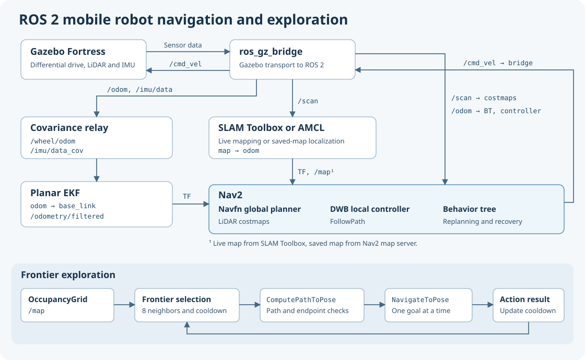

# 基于 ROS 2 的移动机器人自主导航与探索系统

[English](README.md)

本项目在 ROS 2 Humble 和 Gazebo Fortress 中集成差速移动机器人的平面状态估计、SLAM、定位、路径规划和自主探索。机器人可利用实时地图探索未知区域，也可加载已有地图并按航点巡航。

| 技术方向 | 本项目的工作 |
| --- | --- |
| 状态估计 | 接入仿真 IMU 和轮速里程计，利用差速车横向速度约束，验证 EKF 短时表现。 |
| 导航可靠性 | 分析 Navfn 目标容差，在发送导航目标前预检查路径可行性并验证路径终点。 |
| 自主探索 | 在上游前沿检测基础上增加空间冷却、动作结果处理和有上限的候选检查。 |



本项目暂缺可发布的实测 Gazebo 或 RViz 截图、视频和 GIF。仓库包含已保存的占据栅格地图和验证记录。[地图元数据](maps/frontier_explore_v1.yaml) · [实验记录](experiments/2026-11-26-verification.md)

## 系统架构

- Gazebo 通过 `ros_gz_bridge` 向 ROS 2 提供 `/scan`、`/odom`、`/imu/data`、`/joint_states` 和 `/clock`。桥接节点把 Nav2 的 `/cmd_vel` 转发给 Gazebo 差速驱动。
- 协方差中继发布 `/wheel/odom` 和 `/imu/data_cov`。EKF 发布 `/odometry/filtered`，并负责 `odom → base_link`。桥接不转发 Gazebo 的 TF。各连杆的坐标变换由 robot state publisher 提供。
- 实时建图时，SLAM Toolbox 发布 `/map` 和 `map → odom`。使用已保存地图时，Nav2 map server 发布 `/map`，AMCL 发布 `map → odom`。两种模式都使用激光扫描和里程计 TF 链。
- Nav2 使用 TF、地图和雷达代价地图。BT Navigator 的配置明确读取 Gazebo 原始 `/odom`。在默认命名空间中，Controller Server 的相对订阅名 `odom` 也解析为 `/odom`。EKF 发布的里程计消息和 TF 是两种输出。如果把某个 Nav2 节点切到 `/odometry/filtered`，它接收的速度输入会改变，需要单独验证。

## 状态估计

平面 `robot_localization` EKF 将轮速里程计的 `vx`、`vy`、`wz` 与 IMU 的 `wz` 融合。协方差中继保留轮速里程计提供的近零横向速度，并为该测量赋予暂定方差 `1.0e-5`。在侧滑可忽略的差速车模型下，这条测量为滤波器提供横向速度约束。EKF 以 30 Hz 运行并发布 `odom → base_link`。

实验检查了输入主题、参数加载、静止时的横向速度协方差，以及短时后退和转动中的里程计一致性。Gazebo 的原始 `/odom` 是这些对比的参考信号。[EKF 验证记录](experiments/2026-11-26-verification.md#ekf)

## 导航与路径规划

Nav2 使用 Navfn（`GridBased`）做全局规划，以 DWB 的 `FollowPath` 做局部控制。障碍层和膨胀层使用激光数据支持局部避障，全局代价地图还使用占据地图。`NavigateToPose` 的行为树协调路径规划、跟踪、重规划和恢复。行为服务器配置了原地转动、后退、沿航向移动和等待。Navfn、DWB 和行为树均为 Nav2 组件。

Navigation Launch 先加载主参数文件，再给控制器进程叠加覆盖参数。`FollowPath.critics` 仍来自主 YAML。Launch 会应用仿真时钟、可选的 Nav2 命名空间、NavigateToPose 行为树路径和静态地图订阅设置。常规复现使用默认命名空间。若单独为 Nav2 指定其他命名空间，还需要配置匹配的输入和动作客户端。

## 自主探索

上游检测器按照行优先顺序扫描占据栅格内部，将八邻域内至少有一个未知格的空闲格视作前沿。当前版本用栅格分辨率、地图原点位置和原点偏航角，将候选的格心转换到地图坐标系。

每轮最多检查 8 个未进入冷却范围的候选。探索节点异步调用 `ComputePathToPose`，使用 `GridBased` 规划器。候选需要规划成功、路径至少有两个位姿、终点误差不超过 `0.1 m`，才会提交 `NavigateToPose`。节点一次处理一个目标，收到动作结果后等待后续地图更新。如果提交时导航服务还未就绪，节点释放当前候选，并在下一次地图更新时重试，执行器仍可以处理其他回调。

冷却按单调时钟计时 180 秒。导航成功时的排除半径为 `0.45 m`，路径预检查被拒或导航中止时为 `0.65 m`，导航目标被拒或取消时为 `0.60 m`。

## 工程问题与解决过程

| 问题 | 排查与处理 | 验证依据 |
| --- | --- | --- |
| 静止时 EKF 横向速度协方差异常增大 | 检查轮速里程计、IMU 输入和 EKF 参数加载。利用差速车横向速度约束，并为该测量配置显式方差。 | 记录的 60 秒静止检查未再出现极端协方差发散。 |
| 前沿附近反复收到导航成功 | 较大的 Navfn 容差允许路径终点偏离前沿，Nav2 另有 `0.25 m` 的导航目标位置容差。把 Navfn 容差从 `0.5 m` 降到 `0.1 m`，加入终点误差检查，并对已成功目标做空间冷却。 | 运行中读取了规划容差。实验中机器人经过测试房间内的多个区域。 |
| 障碍附近或地图边缘的候选反复触发导航失败 | 上游流程直接提交导航。本项目先异步预检查路径，过滤规划失败、位姿数太少或终点误差过大的候选；尝试过的区域冷却 180 秒。 | 实验观察到多个不可规划候选在提交前被过滤。每轮结束日志给出前沿总数、过滤数、检查数、规划拒绝数和是否达到检查上限。 |
| 组合启动时 DWB 无法激活 | SLAM 的 `params_file` 曾传入 Nav2，导致 DWB 无法加载 critics。组合 Launch 将两个子 Launch 放在独立作用域中；Nav2 再按主参数、控制器覆盖参数的顺序加载。分步启动时检查时钟、传感器、TF 和动作服务即可用。 | 在作用域修复前复现了 `No critics defined for FollowPath`，修复后控制器成功激活。 |

## 实验结果

2026-11-26 冻结实验在测试房间发送了 **4 次导航请求**，其中 **3 次 `SUCCEEDED`、1 次 `ABORTED`**。多个不可规划候选在发送目标前被过滤。这组统计只描述该次运行。

| 历史探索地图 | 结果 |
| --- | ---: |
| 地图尺寸 | 239 × 239 栅格 |
| 分辨率 | 0.05 m/栅格 |
| 空闲 / 占据 / 未知栅格数 | 53,522 / 2,107 / 1,492 |
| 已知 / 未知栅格占比 | 97.39% / 2.61% |
| 剩余前沿栅格 / 八连通区域 | 30 / 12 |

**97.39% 是保存地图矩形内的已知栅格比例。** 该实验未测量所有可达区域的覆盖率，也未建立探索完成判据。

| 历史 EKF 检查 | Gazebo 里程计 | EKF 里程计 | 绝对差 |
| --- | ---: | ---: | ---: |
| 短时后退 | −0.101525 m | −0.101032 m | 0.000493 m |
| 短时转动 | 22.4198° | 22.5586° | 0.1388° |

上述结果衡量的是短时输出与仿真轮速里程计输入的一致性，实验未使用独立真值，也未测定长期精度。地图和计数来自冻结版本；修订后的探索节点使用格心作为目标，轨迹和导航结果可能变化。[历史实验记录](experiments/2026-11-26-verification.md) · [地图文件](maps/)

修订版通过干净构建和前沿探索单元测试。在短时无界面 Fortress 复测中，DWB 加载 7 个 critics 并激活，Navfn 容差为 `0.1 m`。两个通过预检查的前沿目标导航成功，一个在 Nav2 完全激活前被拒，另一个在测试结束时仍在执行。日志还记录了一轮预检查连续拒绝 8 个候选并达到检查上限。独立发送 SIGINT 时，探索节点和协方差中继均正常退出。

另一次已知地图复测中，AMCL 接受初始位姿，巡航通过第一个航点。修订版在第二个航点 `(2, 1)` 多次触发控制器进度检查后超时。已发布的基线在同一航点也触发了该错误，随后通过第二个航点，在第三个航点超时。两轮复测确认基线也会出现进度异常。对比整轮巡航的可靠性仍需要重复实验。本轮复测覆盖无界面仿真，未重测 GUI 或长时间探索。

## 复现步骤

### 安装和构建

使用 Ubuntu 22.04、Python 3、ROS 2 Humble 和 Gazebo Fortress（Gazebo Sim 6.x）。安装 `rosdep` 和 `colcon`。第一次使用 `rosdep` 时，先运行 `sudo rosdep init`，再运行 `rosdep update`。可用 `ign gazebo --versions` 核对 Gazebo 版本。默认仿真 Launch 打开 GUI，需要可用的显示环境和 Ogre2 渲染。[功能包依赖](package.xml)

```bash
source /opt/ros/humble/setup.bash
mkdir -p ~/ros2_ws/src
cd ~/ros2_ws
git clone https://github.com/RongXiang101/ros2-autonomous-vacuum-robot.git src/articubot_one
rosdep install --from-paths src --ignore-src --rosdistro humble -r -y
colcon build --packages-select articubot_one
source install/setup.bash
```

### 分终端启动仿真、SLAM、导航和探索

为每条持续运行的命令使用单独终端。每个终端都加载 ROS 2 Humble 和工作空间环境，使用同一个 ROS 域。

1. 启动测试房间，等待 `/clock`、`/scan` 和 EKF 发布的 `odom → base_link`。

   ```bash
   PKG_SHARE="$(ros2 pkg prefix --share articubot_one)"
   ros2 launch articubot_one launch_sim.launch.py world:="$PKG_SHARE/worlds/slam_test.sdf"
   ```

2. 启动 SLAM Toolbox，等待 `/map` 和 `map → odom`。

   ```bash
   ros2 launch articubot_one online_async_launch.py
   ```

3. 启动 Nav2，等待控制器和 BT Navigator 都进入 `active`，再检查规划器参数和动作服务。另开终端执行检查命令。

   ```bash
   ros2 launch articubot_one navigation_launch.py use_sim_time:=true autostart:=true
   ros2 lifecycle get /controller_server
   ros2 lifecycle get /bt_navigator
   ros2 param get /planner_server GridBased.tolerance
   ros2 action list -t
   ```

4. 确认 `/compute_path_to_pose` 和 `/navigate_to_pose` 可用后，启动探索。需要保存地图时，在另一个已加载环境的终端切到可写目录，并运行地图保存命令。

   ```bash
   ros2 run articubot_one frontier_explorer.py
   ros2 run nav2_map_server map_saver_cli -f "$PWD/frontier_reproduction" \
     --ros-args -p use_sim_time:=true
   ```

### 使用已保存地图定位并巡航

切换模式前停止 SLAM 和探索节点。在相同测试房间内启动定位。用 RViz 的 **2D Pose Estimate** 设置初始位姿，再按上文启动 Nav2。可通过 `map` 参数选择不同的已保存地图。

```bash
PKG_SHARE="$(ros2 pkg prefix --share articubot_one)"
ros2 launch articubot_one localization_launch.py use_sim_time:=true \
  map:="$PKG_SHARE/maps/slam_test_map_v2.yaml"
```

```bash
rviz2 -d "$(ros2 pkg prefix --share nav2_bringup)/rviz/nav2_default_view.rviz" \
  --ros-args -p use_sim_time:=true
```

可用 RViz 的 **Nav2 Goal** 发送手动导航目标。巡航节点依次执行 `map` 坐标系下的三个固定航点 `(1, 0)`、`(2, 1)`、`(0, 1)`，单位为米。完成一轮后退出，失败或取消时提前结束。

```bash
ros2 launch articubot_one patrol.launch.py
```

### 组合启动和单元测试

组合 Launch 以固定延时启动仿真、SLAM、导航和探索，适用于短时启动检查。各节点就绪较慢时，可按前面的步骤分终端启动。

```bash
ros2 launch articubot_one bringup_explore.launch.py
colcon test --packages-select articubot_one --ctest-args -R '^test_frontier_explorer$'
```

## 已知限制

- 当前按栅格扫描顺序结合简单空间过滤选目标，未实现前沿聚类、信息增益评分、路径代价排序或正式的探索完成条件。达到每轮检查上限时仍可能有未检查候选。
- 预检查通过后，Nav2 仍可能重规划。导航目标的验收容差和路径终点预检查阈值各自独立。
- 局部控制采用 Nav2 DWB。当前实现未开发 MPC、Pure Pursuit 或其他运动控制器。
- EKF 的协方差属于暂定值。侧滑或长期缺少绝对观测会降低估计质量。项目验证以仿真为主。

## 上游归属与许可证

Samer Odeh 的上游项目提供了仿真场景、ROS–Gazebo 桥接、SLAM 和 Nav2 集成、DWB 调参及基础前沿探索和巡航节点。机器人模型源于 Josh Newans 的 Articulated Robotics 项目及其 Apache 2.0 的 `my_bot` 前身。上游 `articubot_one` 仓库没有声明仓库级许可证。本仓库保留原文件声明和 Odeh 对其贡献采用的 Apache 2.0 许可证。[Odeh 的项目](https://github.com/samerodeh/ros2_autonomous_robot) · [Articulated Robotics](https://github.com/joshnewans/articubot_one) · [`my_bot`](https://github.com/joshnewans/my_bot) · [LICENSE](LICENSE)

本项目增加并验证了 IMU/EKF 集成、路径可行性检查、目标冷却及单轮巡航，调整了 Navfn 规划容差，并集成现有的 DWB 控制器。`docs/` 内的历史 TF 图沿自上游，本文顶部的架构图展示当前数据流。
